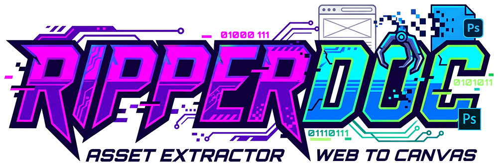

<p align="center">
  
</p>

<p align="center">
  <strong>Asset Extractor // Web to Canvas Photoshop Plugin</strong>
</p>

<p align="center">
  
  
  
  
</p>

---

> [!WARNING]
> **RipperDoc is currently in BETA (v1.0.0-beta).**  
> We are actively testing features across various modern website architectures and Adobe Photoshop versions. If you encounter an unsupported website structure, edge cases, or bugs, please feel free to open an **[Issue](https://github.com/Nephuxs/ripperdoc/issues)**!

---

## ⚡ What is RipperDoc?

**RipperDoc** is a high-speed Adobe Photoshop UXP panel plugin that extracts media assets directly from any public website URL and drops them straight onto your canvas. 

Instead of opening a browser, inspecting elements, screenshotting, or manually saving files to your desktop:
1. Paste a web URL into RipperDoc.
2. Hit **HARVEST ASSETS**.
3. Browse live thumbnails with pixel dimensions and format filtering.
4. Click **RIP** to immediately import the asset into Photoshop as a new layer or open it with full rasterization settings.

---

## 🚀 Key Features

* **Universal Asset Scraping**:
  * **Images**: WebP, AVIF, PNG, JPG/JPEG, SVG, GIF, and ICO (Favicons/Icons).
  * **Video**: MP4, WebM, M3U8 (HLS Streams), TS, MPD (DASH Streams), and MOV.
  * **Audio**: MP3, M4A, AAC, OGG, OPUS, WAV, and WEBA.
  * **Fonts**: WOFF, WOFF2, TTF, OTF, and EOT (with external stylesheet `@font-face` parsing).
* **Single Dropdown Filter**: Compact, space-saving filter button with popup menu and live item count badges for every individual format and category.
* **Direct Photoshop Canvas Integration**: One-click **RIP** sends images and vectors directly onto your active document canvas (with auto-document creation if canvas is empty).
* **Typography & Media Previews**: Custom font cards with typography samples, video hover playback, and audio waveforms.
* **Smart SVG Rasterizer Dialog**: When ripping vector SVGs, Photoshop's native rasterization dialog launches, giving you pixel-perfect resolution controls.
* **Interactive Responsive Grid**: Thumbnails scale dynamically from 70px to 250px via a centered zoom slider.
* **Instant Reboot**: Clear your target URL, reset filters, and purge cached assets with a single click on **REBOOT**.
* **High-Speed Smooth Scrolling**: Accelerated wheel responsiveness for scrolling through hundreds of harvested assets with zero lag.

---

## 💾 Installation Guide

You can install RipperDoc using either the **One-Click Installer (`.ccx`)** or the **Direct Folder Copy**.

### Option 1: One-Click Installer (`.ccx`) — Recommended

1. Download **`RipperDoc.ccx`** from the [**Releases**](https://github.com/Nephuxs/ripperdoc/releases) page.
2. **Double-click** `RipperDoc.ccx`.
3. Adobe Creative Cloud will launch and display:
   > *"Verify Failed: This plugin has not been verified by Adobe"*  
   *(This is normal for all independent/beta plugins outside the public Adobe Marketplace).*
4. Click **Install locally** $\rightarrow$ **OK**.
5. Launch Adobe Photoshop $\rightarrow$ Click **Plugins** on the top menu bar $\rightarrow$ **RipperDoc**.

---

### Option 2: Direct Folder Copy (Zero Installer Needed)

If you prefer not to use Creative Cloud, you can drop the plugin folder directly into Photoshop's native UXP directory:

1. Download **`RipperDoc.zip`** from the [**Releases**](https://github.com/Nephuxs/ripperdoc/releases) page and extract it.
2. Move the extracted `RipperDoc` folder into:
   * **Windows**:
     ```text
     %APPDATA%\Adobe\UXP\Plugins\External\RipperDoc
     ```
     *(Paste `%APPDATA%\Adobe\UXP\Plugins\External` into Windows File Explorer address bar)*
   * **macOS**:
     ```text
     ~/Library/Application Support/Adobe/UXP/Plugins/External/RipperDoc
     ```
3. Restart Photoshop $\rightarrow$ Go to top menu: **Plugins** $\rightarrow$ **RipperDoc**.

---

### Option 3: Developer Sideloading (UXP Developer Tool)

If you are modifying code or contributing:
1. Clone this repository:
   ```bash
   git clone https://github.com/Nephuxs/ripperdoc.git
   ```
2. Open the **Adobe UXP Developer Tool (UDT)**.
3. Click **Add Plugin** $\rightarrow$ select `manifest.json`.
4. Click **•••** $\rightarrow$ **Load** to run the panel in Photoshop with live debugging and DevTools inspection.

---

## 🖥️ Compatibility

| Host Application | Supported Versions | Supported OS |
| :--- | :--- | :--- |
| **Adobe Photoshop** | **22.0.0 through 2026+ (v27.x)** | Windows 10/11 & macOS 12+ (Intel / Apple Silicon) |

---

## 🛠️ Tech Stack

* **UXP (Unified Extensibility Platform) Manifest v5**
* **Photoshop DOM & BatchPlay APIs** (`placeEvent`, `open`, `ActionDescriptor`)
* **Pure JavaScript Scraper** (Native regex and token parsing with zero external browser dependencies)
* **CSS Flexbox UI** optimized for Adobe CEP/UXP rendering engines

---

## 👤 Author & Credits

* **Developer**: [Nephuxs](https://github.com/Nephuxs)
* **Version**: `1.0.0-beta`

Feel free to open an issue or pull request if you want to request new features or report bugs!
